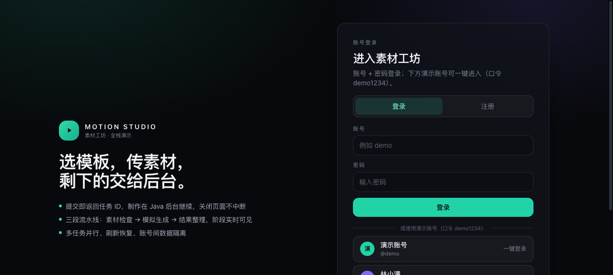
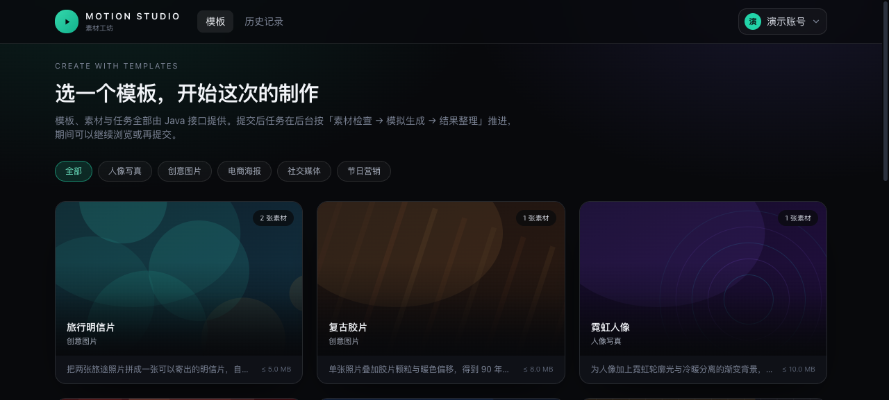
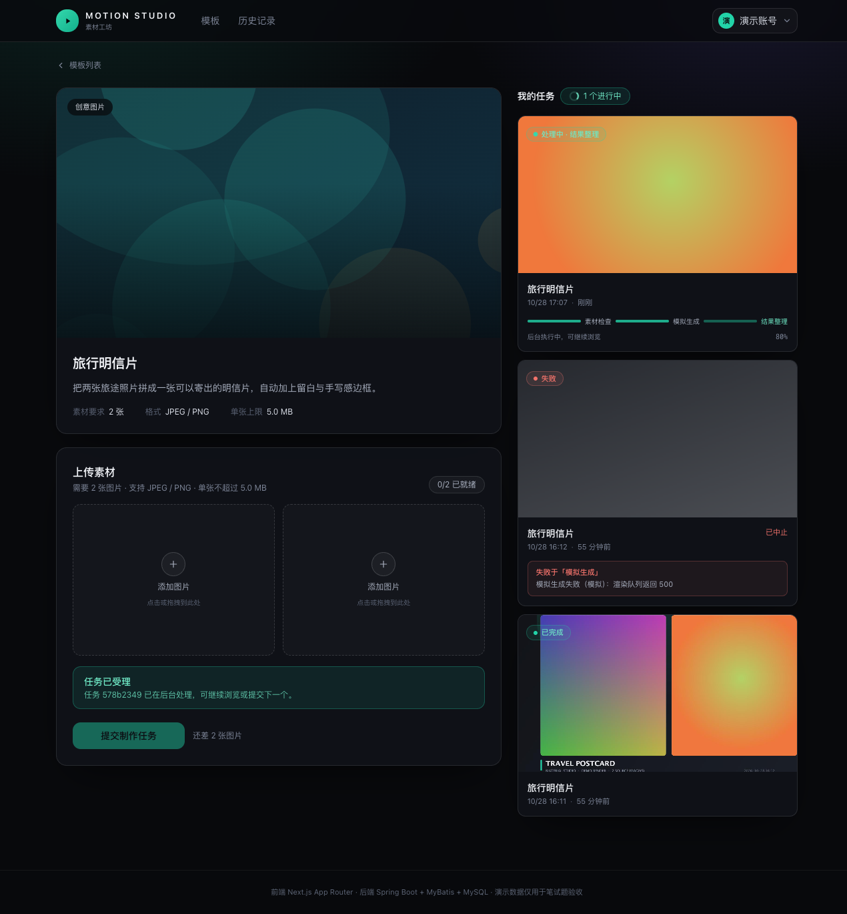
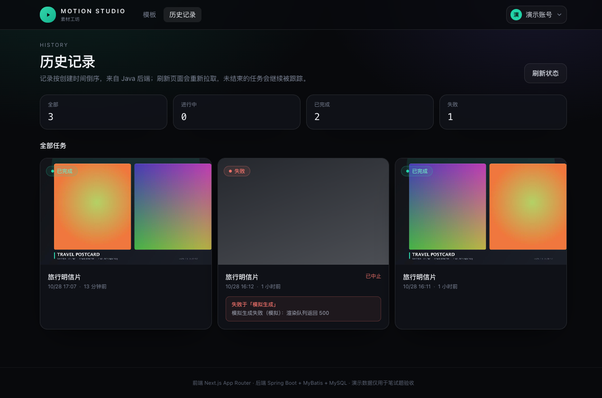
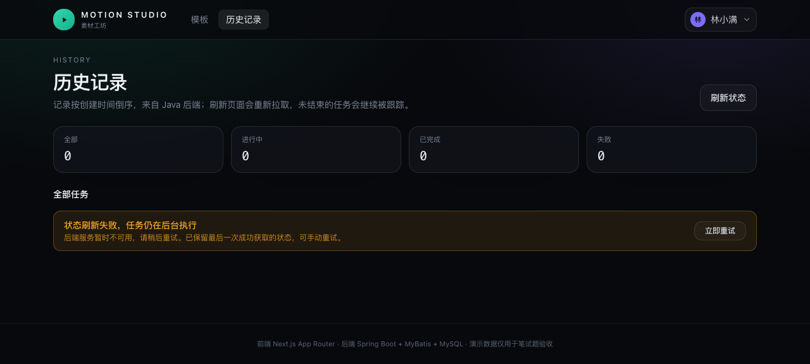

# MOTION STUDIO · 素材制作网站

小影科技 2027 校招 · 全栈开发笔试题实现。

用户浏览模板 → 上传素材 → 提交制作任务 → 任务在 Java 后台按「素材检查 → 模拟生成 → 结果整理」异步执行 → 在历史记录里查看结果。制作不接真实 AI，用可配置耗时与可指定阶段失败的模拟器完成业务闭环。

```
Next.js (App Router)  ──/api/*──▶  Spring Boot  ──MyBatis──▶  MySQL 8
     浏览器同源                   三段异步流水线              任务 / 阶段 / 事件
```

---

## 1. 技术栈与版本

| 层 | 选型 | 版本 | 说明 |
|---|---|---|---|
| 前端框架 | Next.js App Router | 15.x（`^15.1.0`，锁定见 `frontend/package-lock.json`） | 页面 + `/api/*` 接口中间层 |
| UI | React | 19.x | 全部页面为客户端组件，状态由 React Query 驱动 |
| 语言 | TypeScript | 5.7+ | `strict` + `noUncheckedIndexedAccess` |
| 样式 | Tailwind CSS | 3.4 | 深色主题，无 UI 组件库 |
| 服务端状态 | TanStack Query | 5.x | 轮询、缓存、请求异常与任务状态分离 |
| 后端 | Spring Boot | 3.5.0 | Java 21 |
| 持久层 | MyBatis（注解式 Mapper） | starter 3.0.4 | 无 XML，SQL 与接口同处一文件 |
| 数据库 | MySQL | 8.0 / 8.4 均可（本机 8.0.28，CI 8.4） | `utf8mb4_0900_ai_ci` |
| 测试 | JUnit 5 + AssertJ / Vitest + Testing Library | — | 见第 11 节 |
| 容器 | Docker Compose | — | 前端 + 后端 + MySQL 一键启动 |

前端 Node 要求 `>=20 <25`（`package.json` 的 `engines`）。

## 2. 界面预览

| 账号密码登录 | 模板列表 |
|---|---|
|  |  |

| 详情 + 上传 + 处理中 | 历史记录 |
|---|---|
|  |  |

| 查询异常（不判定任务失败） |
|---|
|  |

## 3. 项目结构

```
material-studio/
├── backend/                        Java 后端
│   ├── src/main/java/com/xiaoying/studio/
│   │   ├── asset/                  素材上传、魔数校验、归属校验
│   │   ├── auth → identity/        演示账号、会话、拦截器、@CurrentUser
│   │   ├── common/                 统一异常与错误体、健康检查
│   │   ├── config/                 配置绑定、执行器、Web 配置、演示数据 seeder
│   │   ├── job/                    任务受理、状态机、三段流水线、查询
│   │   ├── render/                 结果整理（Java2D 真实合成 JPEG）
│   │   ├── simulation/             失败阶段 / 耗时模拟（运行时接口）
│   │   ├── storage/                本地存储 + /api/files/** 读取
│   │   └── template/               模板查询
│   ├── src/main/resources/
│   │   ├── application.yml         全部配置项（含环境变量占位）
│   │   ├── db/schema.sql           MySQL 建表（幂等）
│   │   └── demo/covers/*.svg       8 张模板封面（随包发布）
│   └── src/test/                   H2(MODE=MySQL) 集成测试
├── frontend/                       Next.js 前端
│   └── src/
│       ├── app/                    列表 / 详情 / 历史 + /api/[...path] 中间层
│       ├── components/             卡片、上传位、任务列表、状态块
│       └── lib/                    api / hooks / 轮询策略 / 上传 / 格式化
├── tools/generate_covers.py        封面生成脚本（可复现）
├── docker-compose.yml
└── .github/workflows/ci.yml
```

## 4. 快速开始

### 4.1 方式 A：Docker Compose（推荐）

```bash
docker compose up --build
```

- 前端 http://localhost:3000（演示账号 `demo` / `lin` / `chen`，口令 `demo1234`）
- 后端 http://localhost:8080（健康检查 `/api/health`）
- MySQL 容器内 3306，宿主机映射 **3307**（避开本机已有 MySQL）

首次启动后端会自动建表并写入 8 个模板与 3 个演示账号；`storage` 与 `mysql-data` 为命名数据卷。
停止：`docker compose down`；连同数据一起清空：`docker compose down -v`。

> 本机（macOS，无 Docker Desktop 且不能 sudo）未执行过 `docker compose up`，此路径由 CI 的 `compose` job 校验与构建（见第 11 节），README 与 CI 配置等价。

### 4.2 方式 B：本机直接运行

前置：JDK 21、Maven 3.9+、Node 20+、MySQL 8（本机实例为 8.0.28，端口 3306）。

```bash
# 1) 数据库：建库 + 建应用账号
mysql -uroot -e "
CREATE DATABASE IF NOT EXISTS material_studio CHARACTER SET utf8mb4 COLLATE utf8mb4_0900_ai_ci;
CREATE USER IF NOT EXISTS 'studio'@'127.0.0.1' IDENTIFIED BY 'studio123';
GRANT ALL PRIVILEGES ON material_studio.* TO 'studio'@'127.0.0.1'; FLUSH PRIVILEGES;"

# 2) 后端（表结构与模板由应用启动时自动创建）
cd backend
mvn spring-boot:run          # http://localhost:8080

# 3) 前端（新终端）
cd frontend
npm ci
npm run dev                  # http://localhost:3000
```

前端通过自身 `/api/[...path]` 中间层转发到 `BACKEND_URL`（默认 `http://127.0.0.1:8080`），浏览器只与 3000 端口同源通信，因此不存在跨域与 Cookie 问题。

### 4.3 构建与测试命令

| 目标 | 命令 |
|---|---|
| 后端测试 | `cd backend && mvn test` |
| 后端打包 | `cd backend && mvn -DskipTests package` |
| 前端 lint | `cd frontend && npm run lint` |
| 前端类型检查 | `cd frontend && npm run typecheck` |
| 前端单测 | `cd frontend && npm test` |
| 前端构建 | `cd frontend && npm run build` |

## 5. 配置项

后端（`backend/src/main/resources/application.yml`，均可用环境变量覆盖）：

| 变量 | 默认值 | 说明 |
|---|---|---|
| `DB_URL` | `jdbc:mysql://127.0.0.1:3306/material_studio?...` | JDBC 连接串 |
| `DB_USER` / `DB_PASSWORD` | `studio` / `studio123` | 数据库账号（示例值，非真实凭据） |
| `STORAGE_ROOT` | `./storage` | 素材与结果落盘根目录；容器内为 `/app/storage` |
| `SIM_STAGE_DELAY_MS` | `1200` | 每个阶段的模拟耗时（ms） |
| `PIPELINE_WORKERS` | `2` | 后台线程数：>1 并行，=1 排队 |
| `PIPELINE_QUEUE` | `200` | 等待队列容量 |
| `SIM_FAIL_STAGE` / `SIM_FAIL_COUNT` | `NONE` / `0` | 启动时的失败模拟默认值 |
| `CORS_ORIGINS` | `http://localhost:3000,...` | 仅前端直连后端时需要；走中间层可留空 |

前端：

| 变量 | 默认值 | 说明 |
|---|---|---|
| `BACKEND_URL` | `http://127.0.0.1:8080` | 接口中间层转发目标；容器内为 `http://backend:8080` |

无任何真实第三方凭据；`.env.example` 仅为占位示例。

## 6. 数据库、初始化数据与素材

- **表结构**：`backend/src/main/resources/db/schema.sql`，全部 `CREATE TABLE IF NOT EXISTS`，应用启动时执行（`spring.sql.init.mode=always`），可反复启动不报错。
- **表**：`app_user`（含 BCrypt 口令哈希）、`app_session`、`template`、`asset`、`creation_job`、`job_asset`、`job_event`。
- **初始化数据**：`config/DemoDataSeeder` 在模板表为空时写入 8 个模板（5 个分类，素材需求 1/2/3/4 张不等），并补齐 3 个演示账号。放在代码里而非 `seed.sql`，是为了让 MySQL 与测试用 H2 共用一份数据，避免两套 SQL 漂移。
- **素材**：8 张封面是随包发布的 SVG（`backend/src/main/resources/demo/covers/`），由 `tools/generate_covers.py` 生成，无外部图床、无版权风险。用户上传素材落盘在 `storage/uploads/yyyy/MM/<uuid>.<ext>`，结果图在 `storage/results/<jobId>.jpg`。

## 7. 接口

统一响应错误体：`{"code": "...", "message": "...", "timestamp": "..."}`。

| 方法 | 路径 | 说明 | 鉴权 |
|---|---|---|---|
| `GET` | `/api/health` | 健康检查 | 否 |
| `GET` | `/api/auth/accounts` | 演示账号列表（含演示口令，仅演示用） | 否 |
| `POST` | `/api/auth/session` | 账号 + 密码登录，下发 HttpOnly Cookie | 否 |
| `POST` | `/api/auth/register` | 注册并直接登录（BCrypt 存哈希） | 否 |
| `DELETE` | `/api/auth/session` | 退出 | 否 |
| `GET` | `/api/me` | 当前用户 | 是 |
| `GET` | `/api/templates?category=` | 模板列表（含分类清单） | 否 |
| `GET` | `/api/templates/{id}` | 模板详情 | 否 |
| `POST` | `/api/assets` | 上传单张素材（multipart `file`） | 是 |
| `POST` | `/api/jobs` | 受理任务，**立即返回** | 是 |
| `GET` | `/api/jobs/{id}` | 任务详情 | 是 |
| `GET` | `/api/jobs?limit=30` | 我的任务列表 | 是 |
| `GET` | `/api/files/**` | 封面 / 素材 / 结果图 | 否 |
| `GET`/`POST` | `/api/dev/simulation` | 查看 / 设置模拟器 | 否（仅演示环境） |
| `POST` | `/api/dev/simulation/reset` | 恢复默认 | 否 |

模板响应示例：

```json
{
  "id": "travel-postcard",
  "title": "旅行明信片",
  "category": "创意图片",
  "coverUrl": "/api/files/covers/travel-postcard.svg",
  "description": "把两张旅途照片拼成一张可以寄出的明信片……",
  "requiredImageCount": 2,
  "acceptedMimeTypes": ["image/jpeg", "image/png"],
  "maxFileSizeBytes": 5242880
}
```

创建任务请求 / 响应：

```http
POST /api/jobs
{"templateId": "travel-postcard", "assetIds": ["<uuid>", "<uuid>"]}

201 Created
{
  "id": "2e1efacb-...",
  "templateTitle": "旅行明信片",
  "status": "PENDING",
  "stage": "QUEUED",
  "stageLabel": "排队中",
  "progress": 0,
  "errorStage": null, "errorMessage": null, "resultUrl": null,
  "createdAt": "2026-10-28T16:11:57.545592",
  "assets": [{"id": "<uuid>", "url": "/api/files/uploads/2026/10/xxx.png"}]
}
```

查询（终态示例）：

```json
{
  "status": "SUCCEEDED",
  "stage": "DONE",
  "progress": 100,
  "resultUrl": "/api/files/results/<jobId>.jpg",
  "startedAt": "2026-10-28T16:11:58.1", "finishedAt": "2026-10-28T16:12:01.7"
}
```

失败示例：

```json
{
  "status": "FAILED",
  "stage": "GENERATE",
  "errorStage": "GENERATE",
  "errorMessage": "模拟生成失败（模拟）：渲染队列返回 500"
}
```

## 8. 任务状态与后台执行

**状态与阶段分离**：

| `status` | 含义 | `stage` | 含义 |
|---|---|---|---|
| `PENDING` | 已受理、排队中 | `QUEUED` | 等待后台线程 |
| `PROCESSING` | 执行中 | `MATERIAL_CHECK` | 素材检查 |
| `SUCCEEDED` | 全部成功 | `GENERATE` | 模拟生成 |
| `FAILED` | 某一步失败 | `FINALIZE` | 结果整理 |
| | | `DONE` | 已完成 |

**执行方式**：`JobService.create()` 在校验与落库后，通过 `TransactionSynchronization.afterCommit` 把任务 ID 投给 `ThreadPoolTaskExecutor`（`PIPELINE_WORKERS` 个线程 + 队列）。线程池在进程内，没有引入 MQ。

**为什么查询不会推进任务**：所有状态写入只发生在 `JobPipeline` 的方法里，查询接口走 `@Transactional(readOnly = true)`，只读不写；状态更新 SQL 还带 `AND status = 'PROCESSING'` 守卫，终态任务不可能被改回处理中。

**可观察的执行边界**：每次阶段开始/完成/失败都写一条 `job_event`，`stage` + `progress` 同步更新到 `creation_job`，前端轮询看到的是服务端真实阶段，而不是前端定时器切换文案。

**结果整理**是真的做事：`ResultComposer` 用 Java2D 读取用户素材、按 cover 裁切、圆角排布，合成 1200×800 JPEG 写入 `storage/results/<jobId>.jpg`（画布上的文字只用 ASCII，避免容器缺少中文字体渲染成方块）。

## 9. 演示脚本

### 9.1 成功链路

1. 打开 http://localhost:3000，选择「演示账号」。
2. 选任意模板（如「旅行明信片」，需要 2 张图）。
3. 在两个上传位各选一张 JPG/PNG：可看到 `上传中 xx%` → `已就绪`；上传位支持替换、移除、拖拽。
4. 点「提交制作任务」：按钮短暂显示「提交中…」，**受理后立即恢复**，右侧「我的任务」立刻出现一张卡片。
5. 观察卡片阶段条依次点亮：素材检查 → 模拟生成 → 结果整理（默认每步 1.2 秒，可调）。
6. 完成后点卡片底部「查看制作结果」，弹出结果图预览。

### 9.2 指定阶段失败（可重复）

```bash
# 让接下来 1 个任务在"模拟生成"阶段失败
curl -s -X POST http://localhost:8080/api/dev/simulation \
  -H 'Content-Type: application/json' \
  -d '{"failStage":"GENERATE","failCount":1}'

# 让后续所有任务在"素材检查"阶段失败
curl -s -X POST http://localhost:8080/api/dev/simulation \
  -H 'Content-Type: application/json' -d '{"failStage":"MATERIAL_CHECK","failCount":-1}'

# 恢复正常
curl -s -X POST http://localhost:8080/api/dev/simulation/reset
```

`failCount`：`n` = 接下来 n 个任务在该阶段失败；`-1` = 一直失败；`0`/reset = 关闭。
失败后该任务停止后续阶段，记录 `errorStage` 与可读原因，前端卡片显示「失败于「模拟生成」」+ 原因。

### 9.3 调整处理耗时（便于观察处理中与多任务）

```bash
curl -s -X POST http://localhost:8080/api/dev/simulation \
  -H 'Content-Type: application/json' -d '{"stageDelayMs":6000}'
```

也可以启动时通过 `SIM_STAGE_DELAY_MS=6000` 设置；调成 0 则阶段瞬间完成（测试用）。

### 9.4 多任务与刷新恢复

- 连续提交 3 个任务：右侧卡片各自独立推进，互不串扰；线程池 2 个 worker 时第 3 个会短暂 `PENDING`（排队）。
- 任务进行中刷新页面：历史从后端恢复，未结束任务继续被跟踪，直到终态。
- 任务结束后轮询自动停止（Network 面板不再有 `/api/jobs` 请求）；有新任务时自动恢复。
- 切换账号：任务列表整体替换为该账号的数据，旧请求结果不会覆盖新账号内容（切换时清空 React Query 缓存）。

### 9.5 请求异常 ≠ 任务失败

停掉后端（`Ctrl+C`）后刷新页面：前端展示「状态刷新失败，任务仍在后台执行」并保留最后一次成功状态，提供「立即重试」；不会把任务标成失败。重启后端后点重试即恢复。

## 10. 用户身份与个人记录

**方案：自建账号 + 密码（BCrypt），不做第三方登录。**

| 环节 | 实现 |
|---|---|
| 注册 | `POST /api/auth/register`：账号（2-32 位，字母/数字/`_`/`-`，统一转小写）+ 密码（6-64 位）+ 可选昵称；账号重复返回 `409 HANDLE_TAKEN` |
| 存储 | `app_user.password_hash` 存 **BCrypt** 哈希（`spring-security-crypto`，只引哈希工具，不启用 Security 过滤器链），明文永不落库、永不返回 |
| 登录 | `POST /api/auth/session`：校验失败统一返回 `401 INVALID_CREDENTIALS / 账号或密码不正确`，不区分"账号不存在"与"密码错误"，避免账号枚举 |
| 会话 | 登录/注册成功签发不透明 UUID 令牌，存 `app_session` 表（含过期时间），通过 `HttpOnly; SameSite=Lax; Path=/` Cookie 下发，默认 7 天；退出即删库中令牌并清 Cookie |
| 隔离 | `creation_job` / `asset` 都带 `user_id`，查询与提交按当前用户过滤；用他人 `assetId` 返回 403，读他人任务返回 404（不泄露存在性） |
| 切换 | 右上角菜单可切换/重新登录；切换时前端 `setQueryData(me)` + `resetQueries(jobs)`，旧账号任务不会残留 |

**演示账号**（`DemoDataSeeder` 启动时写入，口令统一 `demo1234`）：`demo` / `lin` / `chen`。
登录页的"一键登录"按钮直接使用 `/api/auth/accounts` 下发的演示口令，方便验收，不写死在前端。

**演示方法**：用 `demo` 提交两个任务 → 退出 → 用 `lin` 登录 → 历史为空 → 再切回 `demo` → 任务仍在。

**升级提示**：`schema.sql` 是 `CREATE TABLE IF NOT EXISTS`，如果你之前跑过旧版本（无 `password_hash` 列），执行一次：

```sql
ALTER TABLE app_user ADD COLUMN password_hash VARCHAR(100) NOT NULL DEFAULT '' AFTER display_name;
```

应用启动时会给演示账号自动补哈希，其余旧账号需重新注册。

## 11. 测试与 CI

### 后端（`backend/src/test`）

| 用例 | 断言的行为 |
|---|---|
| `runsStagesInOrderAndProducesResult` | 三段阶段事件严格按 `MATERIAL_CHECK → GENERATE → FINALIZE` 顺序；成功后 `status=SUCCEEDED`、`stage=DONE`、结果 JPEG 真实落盘 |
| `failureStopsFollowingStages` | 指定 `GENERATE` 失败后：`FAILED` + `errorStage=GENERATE` + 无任何 `FINALIZE` 事件 + 失败只消耗一次配额 |
| `terminalJobIsNotRerunNorReverted` | 终态任务再次投递被 `markStarted` 拦下；反复查询不会改变状态 |
| `rejectWhenAssetCountMismatch` | 素材数量与模板要求不符时拒绝受理 |
| `rejectCrossUserAccess` | 不能使用他人素材、不能读他人任务 |
| `ImageTypeDetectorTest` | 按魔数识别图片，拒绝伪装文件 |
| `AuthServiceTest`（4 例） | 注册后可用同口令登录且库中只有 BCrypt 哈希；密码错与账号不存在返回同一错误；重复账号/弱口令/非法账号被拒；演示账号口令可用 |
| `AuthServiceTest`（4 例） | 注册后可用同口令登录且库中只有 BCrypt 哈希；密码错与账号不存在返回同一错误；重复账号/弱口令/非法账号被拒；演示账号口令可用 |

测试用 **H2（MODE=MySQL）**，无需外部数据库即可 `mvn test`；测试 profile 把执行器替换为同步实现，因此流水线在测试线程内可完整断言。

> H2 结构文件 `src/test/resources/db/schema-h2.sql` 与生产 `db/schema.sql` 一一对应，差异仅限 MySQL 专有语法（`ENGINE`/`COMMENT`/内联 `KEY`）。

### 前端（Vitest + Testing Library）

| 用例 | 断言的行为 |
|---|---|
| `jobs.test.ts` | 有 `PENDING/PROCESSING` 才轮询；全部终态、空列表、未加载 → 返回 `false` 停止 |
| `JobList.test.tsx` | 三个任务（处理中/失败/成功）的状态、阶段、错误互不串扰 |
| 同上 | 查询异常时保留旧任务状态，只提示「状态刷新失败」，不标记任务失败 |
| 同上 | 从未取到数据 → 整块错误 + 重试；无数据 → 空状态 |

### 本机实测记录（2026-10-28，macOS arm64 / JDK 21.0.12 / Node 22.22.2 / MySQL 8.0.28）

| 检查项 | 命令 | 结果 |
|---|---|---|
| 后端测试 | `mvn test` | **11 个用例**全通过（H2） |
| 后端打包 | `mvn -DskipTests package` | 27 MB 可执行 jar |
| 前端 lint | `npm run lint` | 0 error / 0 warning |
| 前端类型 | `npm run typecheck` | 通过 |
| 前端单测 | `npm test` | 11 个用例全通过 |
| 前端构建 | `npm run build` | 15.5.28，6 条路由 |
| 锁文件一致性 | `npm ci --dry-run` | 通过 |
| standalone 运行 | `node .next/standalone/server.js` | 200，静态资源正常 |
| 手工链路 | 浏览器实跑 | 登录 → 上传（进度）→ 受理 → 阶段推进 → 结果预览；`GENERATE` 失败中断；停后端出现异常提示且可重试；切换账号后历史为空 |
| Compose | `docker compose config -q` / `up` | **未执行**（本机无 Docker），仅做 YAML 结构解析 |

### CI（`.github/workflows/ci.yml`）

push / PR 触发，4 个 job：

1. `backend`：JDK 21，`mvn -B verify`（编译 + 测试 + 打包）。
2. `frontend`：Node 22，`npm ci` → `lint` → `typecheck` → `test` → `build`。
3. `mysql-smoke`：起 MySQL 8.4 service，用真实 MySQL 启动 jar 并请求 `/api/health`、`/api/templates`，验证 MySQL 方言与初始化脚本。
4. `compose`：`docker compose config -q` + `docker compose build`，校验容器交付可构建。

## 12. 部署与回滚

- **部署**：`docker compose up -d --build`；健康检查 `curl localhost:8080/api/health`；前端 `curl -I localhost:3000`。
- **升级**：拉新代码 → `docker compose up -d --build`（镜像按内容重建，旧容器自动替换）；数据库结构为幂等 `CREATE TABLE IF NOT EXISTS`，本期无破坏性变更。
- **回滚**：`docker compose down` 后用上一个 commit 重新 `up -d --build`；数据卷 `mysql-data`、`media` 保留，回滚不丢历史任务与素材。
- **注意**：`storage` 与数据库必须成对回滚（结果图路径写在库里），单独回滚其一会导致历史结果 404。

## 13. 完成度、已知限制与实际投入

**已完成**：R-01 ~ R-14 全部条目（列表/详情/上传/校验/受理/三段流水线/状态查询/失败与耗时模拟/多任务/刷新恢复/历史/身份隔离/CI/Compose/README）。

**已知限制（如实说明）**：

1. **重启恢复**：不实现"服务重启后自动继续执行"。重启时处于 `PROCESSING` 的任务会停留在该状态（题目明确列入"不在范围内"）。取舍：需要持久化调度与租约，代价远超本题范围；README 记录而不隐藏。
2. **受理幂等 / 断点续跑 / 自动重试**：未实现（题目不要求）。幂等可由客户端 `requestId` + 唯一索引实现，50 行内可加，但会改变接口契约，故只在此讨论。
3. **Docker 本地验证**：本机无 Docker 且不能 `sudo`，`docker compose up --build` 未在本机跑过；Compose 与 Dockerfile 的正确性依赖 CI 的 `compose` job，以及同一套 Java/Node 构建命令在本机的实测。**这是唯一未在本机验证的交付项。**
4. **身份是自建账号密码**：BCrypt 存储、会话存库（非 JWT），没有邮箱验证、找回密码、限流与验证码；生产还需加登录失败计数与 CSRF 防护。
5. **`/api/dev/**` 无鉴权**：仅用于验收演示，生产应移除或加开关（可用 `app.simulation.enabled=false` 关闭，当前未加该开关）。
6. **结果图排版**：固定三种布局（1/2/3 张），4 张模板只取前 3 张参与合成；画布文字仅 ASCII。
7. **未做端到端浏览器测试**（题目不要求），前端只覆盖纯逻辑与组件渲染。

**实际投入**：待填写（建议按 `git log` 首末 commit 时间差 + 分段记录填写）。取舍上优先保证"状态机正确 + 失败可控 + 异步状态可解释"，其次才是视觉还原度。

## 14. AI 工作流（使用了 AI）

**拆解**：先按 R 编号列出验收点，把"能跑通的最小闭环"和"评分细则"分开；先定状态机与接口契约（`status` × `stage` × `progress` + `job_event`），再写代码。

**上下文**：把题目原文、参考截图要点、技术栈约束一次性喂给模型，明确"不要引入 MQ/Redis/SSE"等边界，避免它自行加戏。

**生成/修改**：后端与前端骨架由模型生成，我逐文件审查并改写关键处：
- 事务与投递时序（`afterCommit` 才投递，否则线程读不到未提交的任务）；
- 状态更新 SQL 的 `AND status='PROCESSING'` 守卫（终态不可回退）；
- `@ConditionalOnMissingBean` 与 `destroyMethod` 的冲突导致上下文启动失败 → 改为按配置返回同步/线程池执行器，测试才能断言流水线。

**验证**：`mvn test`（7 个用例）→ 本地起服务用 curl 跑通"登录 → 上传 → 受理 → 轮询 → 结果图"→ 用模拟接口触发失败 → 目检结果 JPEG → 前端 `lint/typecheck/test/build`。**验证环节全部由我执行，模型输出只作为初稿。**

## 15. 验收信息与第三方来源

- **功能提交**：`4970804`（特性完整实现）；验收请以仓库 HEAD 为准（`git log -1`），文档微调不影响功能
- **仓库结构**：单仓双端（`backend/` + `frontend/`），根目录即 Compose 启动点

### 第三方来源与复用

- 框架与库均为开源依赖，见 `backend/pom.xml`、`frontend/package.json` 与锁文件。
- 模板封面为 `tools/generate_covers.py` 自绘 SVG，无第三方素材。
- 无脚手架模板复制（项目结构按本题需要手写），无公司内部代码或付费资源。
